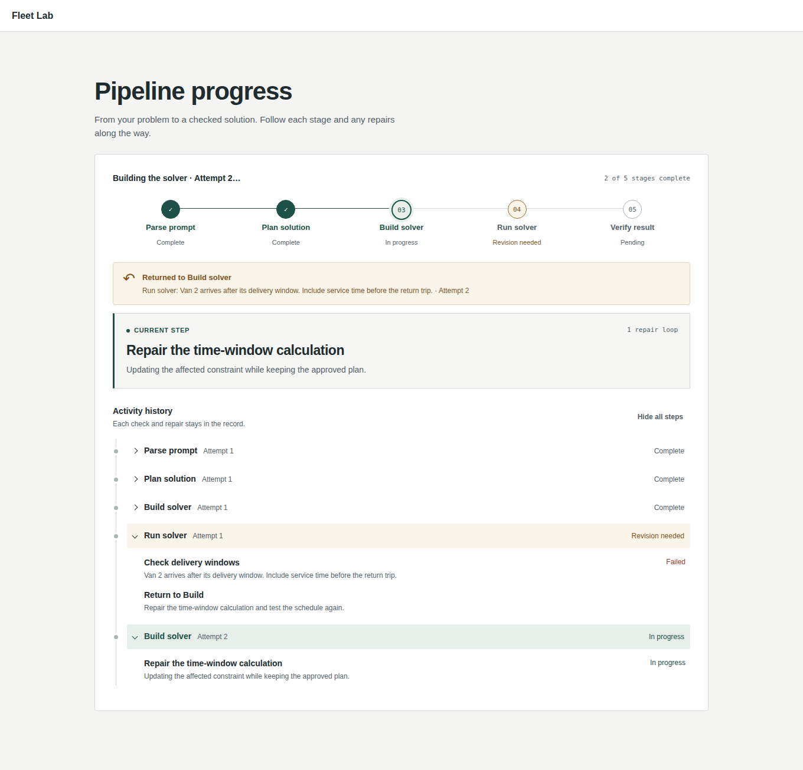
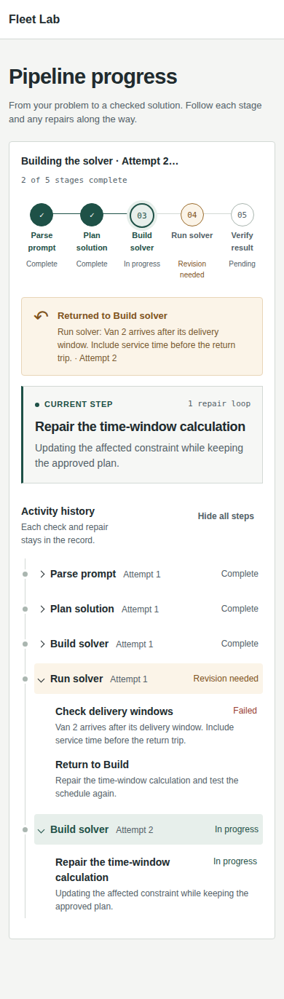

# Agent loop visualization evidence

Captured from the running frontend in Linux Chromium, light mode. Progress
responses use a deterministic test fixture; no model calls are made. Desktop
captures use a 1360 × 1080 viewport and mobile captures use 390 × 844. Images
include the full page.

The main state is a failed delivery-window check returning to Build, attempt 2.
The earlier attempt and its findings remain available while the repair runs.

| State | Before | After |
| --- | --- | --- |
| Desktop, repair in progress | [Before](before-desktop.png) | [After](after-desktop.png) |
| Mobile, repair in progress | [Before](before-mobile.png) | [After](after-mobile.png) |
| Mobile, failed planning attempt reopened | — | [After](after-failed-mobile.png) |

Before captures show commit `e639dcb`, before the frontend changes. After captures
are produced by `tests/browser/pipeline-progress.cjs`; see the
[development guide](../../DEVELOPMENT.md#agent-loop-progress) for the command.

Browser checks also exercise a 320px viewport, opening an attempt with the
keyboard, preserving focus through polling, showing/hiding all details, and
returning from a failed attempt to the problem screen.

