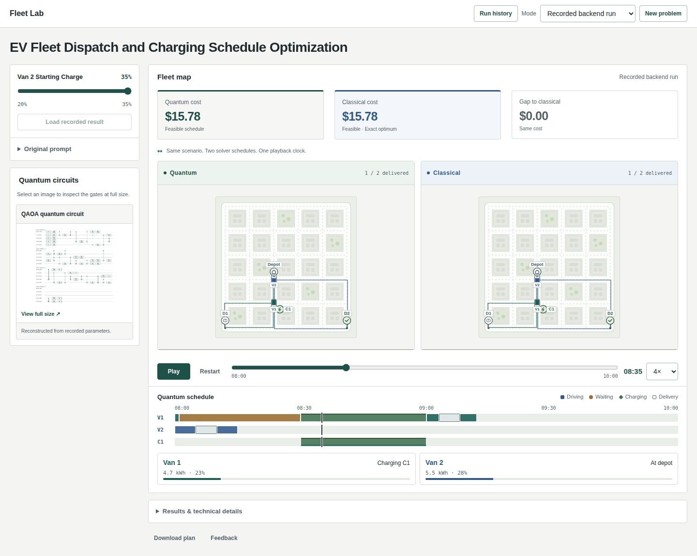
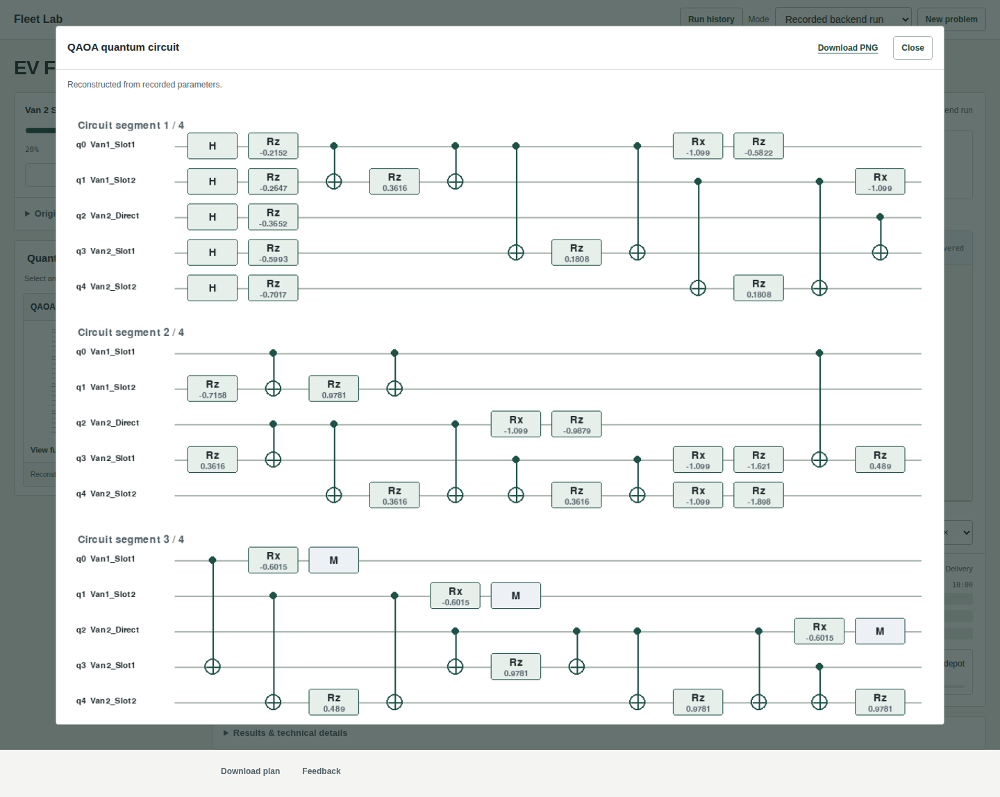

# Circuit images in the sidebar

Linux Chromium, light mode, running local dashboard with the checked-in verified
EV recording at minute 35. No model API calls were made. The recorded circuit is
reconstructed with the solver's own QAOA builder, angles, and qubit mapping; the
caption identifies it as a reconstruction. Native run images are captured from
their verified workspace instead.

| State | Before | After |
| --- | --- | --- |
| Desktop, 1440 × 1080 | [Before](../fleet-comparison/after-desktop.png) | [Left sidebar](after-desktop.png) |
| Mobile, 390 × 844 | [Before](../fleet-comparison/after-mobile.png) | [Stacked sidebar](after-mobile.png) |
| Desktop, full-size viewer | — | [Circuit viewer](after-dialog-desktop.png) |

The comparison browser check also covers a 320px viewport and reduced motion.
It verifies image loading, exact preview-to-viewer selection, Escape/focus return,
PNG download, and a different circuit image for the 20% recording. Classical-only
mode clears the quantum circuit panel. Backend checks cover native attempt
cleanup, saved image/result/digest matching, bounded PNG validation, and legacy
text drawings.

To reproduce after images with a local dashboard and Playwright:

```sh
SKIP_VIDEO=1 DASHBOARD_URL=http://127.0.0.1:8000 EVIDENCE_DIR=/absolute/output/directory node tests/browser/fleet-comparison.cjs
```




