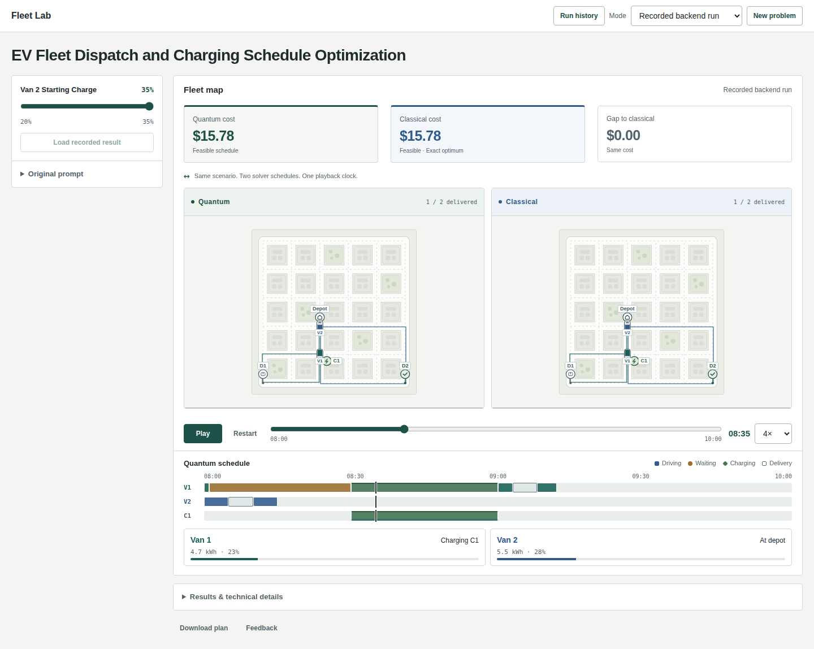
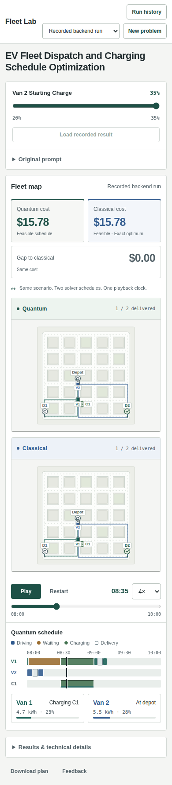

# Quantum/classical comparison evidence

Captured from the running local dashboard in Linux Chromium, light mode, using
the checked-in verified EV recording. No live model API was called. Both maps
show minute 35 on the same operating clock and use the same scenario/settings.
The sample quantum schedule matches the exact classical cost; the UI makes no
quantum-advantage claim.

| Platform | Before | After |
| --- | --- | --- |
| Desktop, 1440 × 1080 | [Before](before-desktop.png) | [After](after-desktop.png) |
| Mobile, 390 × 844 | [Before](before-mobile.png) | [After](after-mobile.png) |

Before captures use commit `bd85aec`. After captures show the ported comparison
with green quantum and blue classical panels, factual costs/gap, separate
delivery counts, and shared playback controls.

[Watch synchronized playback](synchronized-playback.webm). This browser recording
shows explicit Play/Pause, animated vehicles, independent map inspection, mode
fallback, and a local solve followed by reuse of verified settings. No autoplay
is enabled. Decorative pulses, trails, and metric transitions respect reduced
motion; deliberate playback remains available.

`tests/browser/fleet-comparison.cjs` exercises the real local service at desktop,
390px, 320px, and reduced-motion viewports. It checks cost/proof labels, synchronized
seek/delivery counts, changing canvas frames during playback, pause, keyboard
inspection, single-map fallback, overflow/errors, and verified cache reuse when
the built-in local backend is available.

```sh
# Start the dashboard separately. Requires Playwright with Chromium.
DASHBOARD_URL=http://127.0.0.1:8000 node tests/browser/fleet-comparison.cjs
```

Set `EVIDENCE_DIR` to an absolute directory to reproduce the after screenshots
and video. `PLAYWRIGHT_MODULE` and `BROWSER_EXECUTABLE` can select an existing
browser installation.




