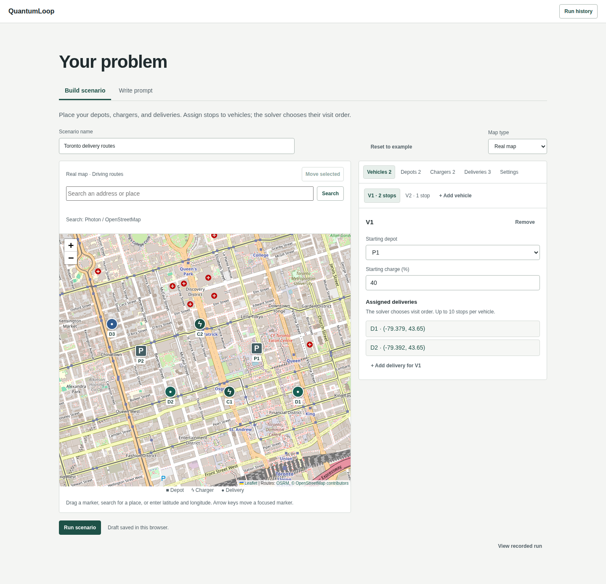
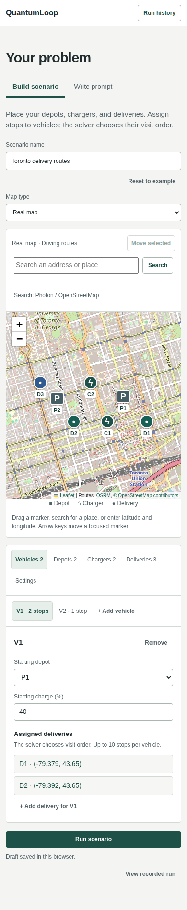

# Geographic maps evidence

Captured in Linux Chromium, light mode. Desktop uses 1440 × 1080; mobile uses
390 × 844. Images include the full page. Before captures show the merged grid
builder at `c749c44`; after captures show this branch.

| State | Desktop | Mobile |
| --- | --- | --- |
| Before: street-grid builder | [Before](before-desktop.png) | [Before](before-mobile.png) |
| Real-map editor, multiple depots and stops | [After](after-editor-desktop.png) | [After](after-editor-mobile.png) |
| Road geometry and synchronized replay | [After](after-replay-desktop.png) | [After](after-replay-mobile.png) |

After captures display actual OpenStreetMap tiles and saved OSRM driving data
for seven example Toronto locations. The independently verified fixture has
five selected driving legs and 207 road geometry points. Photon address search
was also checked against the live service. Attribution remains visible.

The replay screenshots explicitly say **no quantum run**. Their schedule is a
deterministic contract fixture; counts are empty and no circuit measurements
are invented. The road data is real. The saved fixture is
`tests/fixtures/geographic-road-replay.json`, with provider/source attribution.

`tests/browser/geographic-maps.cjs` uses local test tiles and synthetic provider
responses for repeatable desktop, 390px and 320px checks: selecting either map
type, separate draft restoration, address search, coordinate and keyboard edits,
road playback, numeric reuse, fresh routing after moving locations, and failure
recovery. It makes no model or provider requests. Existing builder, progress,
and recorded/reference browser suites also pass across their viewports.

Capture the real-map views from `quantum-playground`:

```sh
EVIDENCE_DIR="$PWD/docs/evidence/geographic-maps" \
  node tests/browser/geographic-evidence.cjs
```

This loads only currently visible OSM tiles using normal browser caching; it
does not prefetch areas or download an offline tile archive. Set
`PLAYWRIGHT_MODULE` and `BROWSER_EXECUTABLE` for local installations.




