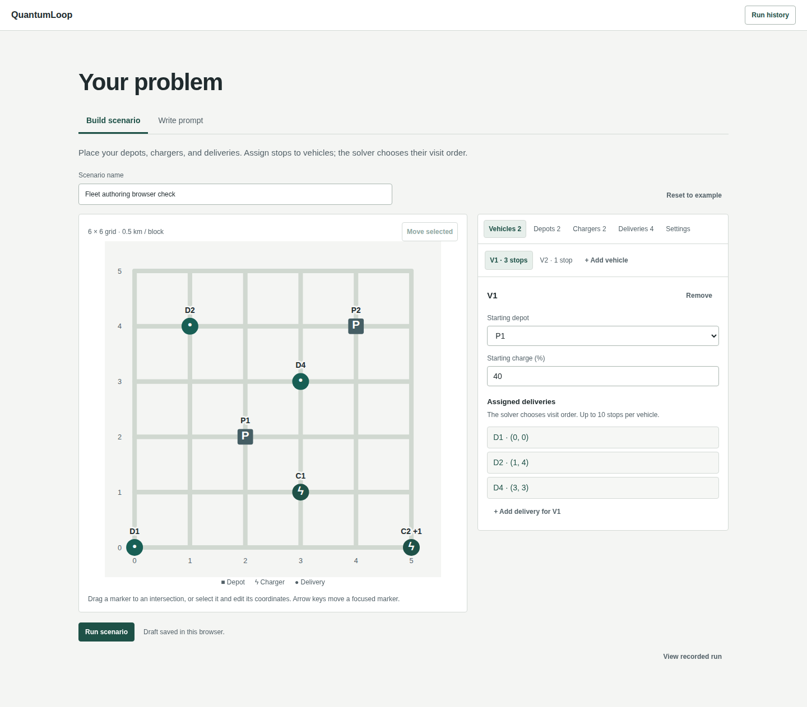
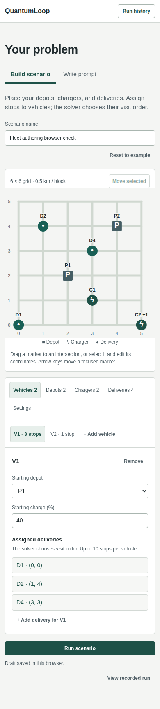

# QuantumLoop scenario builder evidence

Captured from the running frontend in Linux Chromium, light mode. Desktop after
captures use 1440 × 1080 (before: 1440 × 1000); mobile uses 390 × 844. Images include the full page.
Before captures use `origin/main` before this PR; after captures use the new
builder and QuantumLoop branding.

| State | Desktop | Mobile |
| --- | --- | --- |
| Before: text-only entry | [Before](before-desktop.png) | [Before](before-mobile.png) |
| Builder: two depots, two chargers, three stops on V1 | [After](after-builder-desktop.png) | [After](after-builder-mobile.png) |
| Verified fixture replay: four deliveries across two home depots | [After](after-result-desktop.png) | [After](after-result-mobile.png) |
| Failed solve: editable draft and recovery message | [After](after-error-desktop.png) | [After](after-error-mobile.png) |

The authoring browser check serves the real assets and uses deterministic
schedule fixtures that pass the independent scenario verifier. Fixtures contain
no quantum measurements and identify that no quantum execution occurred.
These screenshots demonstrate the UI and contract; they are not evidence of a
model-provider or quantum run.

`tests/browser/scenario-builder.cjs` checks desktop, 390px, and 320px layouts,
keyboard movement, tap-to-place, overlapping objects, invalid-draft restoration,
grid shrinking, multiple stops, settings reuse, location-triggered replanning,
failed-run recovery, saved-run editing, and prompt-mode keyboard navigation.

The legacy progress and fleet comparison browser checks also pass. The latter
uses actual saved replays and ran the local NumPy solver at 35%, 22%, and 35%
starting charge, including verified cache reuse. Native model credentials were
not configured for a fresh generated scenario; pipeline integration tests cover
that path with model responses replaced and real solver subprocesses.

Reproduce from `quantum-playground` with Playwright and Chromium installed:

```sh
EVIDENCE_DIR="$PWD/docs/evidence/scenario-builder" PYTHON=python3 \
  node tests/browser/scenario-builder.cjs
```

Set `PLAYWRIGHT_MODULE` and `BROWSER_EXECUTABLE` when using local installations.




